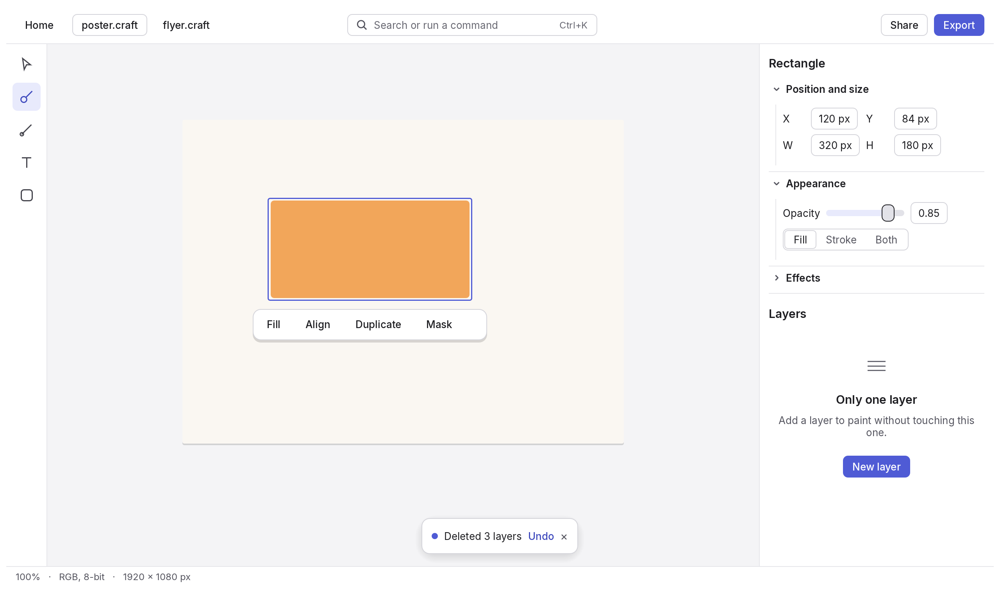
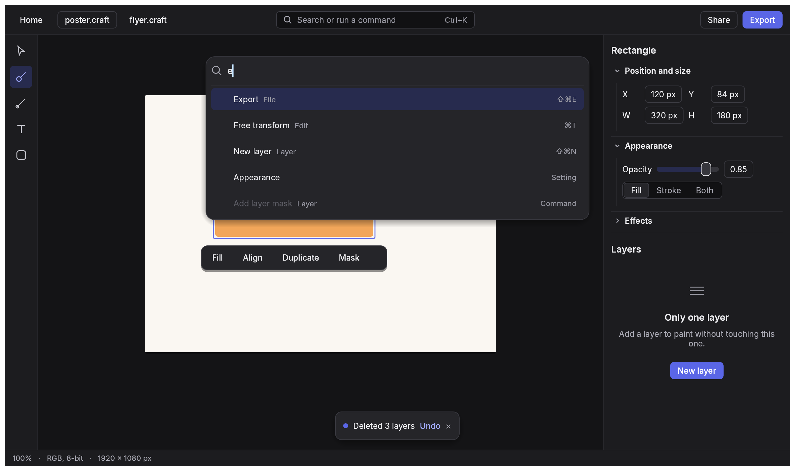

# Craft design direction

All craft apps (PdfCraft, PhotoCraft, VectorCraft, FilmCraft, EffectCraft, DesignCraft,
LightCraft) share one design of our own, built once in the [`craft-ui`](crates/craft-ui) crate. **Feature parity with the
professional apps each one targets stays the goal; their look and interaction design are not
copied.** Observing another vendor's app is fine for *behaviour*; never measure, sample or trace
its colours, sizes, icons, layout or wording.

## Principles

When two conflict, the earlier one wins.

1. **Learn once, use everywhere.** The same action looks, sits and is named the same in every
   craft app, with the same shortcut.
2. **Content first, calm chrome.** The document gets the space and the colour. Chrome is quiet
   neutral greys with one accent, used only for selection, focus and the primary action.
3. **Show what fits the moment.** One inspector and a floating action bar show the controls for
   the selection, instead of twenty panels open at once. Everything else is one search away.
4. **Find anything by typing.** Every command, tool, setting and help topic is in the ⌘K palette.
5. **Forgiving by default.** Actions apply at once and can be undone from a toast; confirmations
   are kept for what undo cannot reverse. Previews are live, dialogs are rare and never stack.
6. **Plain words.** Sentence case, everyday language. Empty panels say what they are for and
   offer the first step. Errors say what happened and what to do next.
7. **Accessible and adjustable.** WCAG AA contrast (enforced by `tokens::tests`), everything
   works from the keyboard, focus is always visible, UI scale 75–200 %, reduced motion honoured.

## The shell

Every app has the same regions in the same places:

| Region | Contents |
| --- | --- |
| Top bar | Home, document tabs, the search field that opens the palette (centre), the primary action (right). Task modes that are different screens (FilmCraft Import / Edit / Export, LightCraft Library / Edit) are tabs in the centre. |
| Tool rail (left) | Icon buttons with tooltips (name, key, one line). Hidden in apps without canvas tools. |
| Canvas | The document. The action bar floats next to the selection. Toasts sit at the bottom centre. |
| Inspector (right) | Properties of the selection in collapsible sections; below it, one secondary panel at a time (Layers, Pages, Assets…). |
| Status bar | Zoom, colour mode, size, background jobs. |

FilmCraft and EffectCraft add a timeline above the status bar. Panels can still be docked,
floated and rearranged; arrangements save as named **layouts** (Default, Focus, plus a few task
layouts named by the task), never a long list of vendor workspace names.

## Tokens

Defined in [`src/tokens.rs`](crates/craft-ui/src/tokens.rs); apps add domain tokens (timeline, keyframes, colour
labels) derived from these, never their own greys.

- **Appearance:** System (default), Light, Warm, Dim, Dark, High contrast. None but High
  contrast uses pure white or pure black: Light is off-white, Warm is an off-white with a faint rose tint and a red
  accent, Dim is mid grey for long sessions. Photo, video and motion apps
  pass `prefer_dark` so System draws dark when the OS says nothing. Older builds' theme names
  map with `Appearance::parse`.
- **Colour:** cool neutral greys and one accent, Craft Indigo (#4F5BD5 light, #5A66E6 dark
  and dim, red #B3261E in Warm, yellow #FFD23F in High contrast). Status colours (success, warning, danger) are for status
  only.
- **Type:** Inter for the UI, JetBrains Mono for changing numbers. Caption 11, small 12, body 13,
  title 15 semibold, heading 18 semibold. Font files stay in each app (or craft-fonts); call
  `fonts::install` so the named weights always exist.
- **Spacing:** 4 px grid (4, 8, 12, 16, 24, 32). **Density:** Comfortable (28 px controls,
  default) or Compact (24 px).
- **Radius:** 4 fields and chips, 6 buttons, 10 panels and menus, 14 dialogs and the palette.
- **Elevation and motion:** flat panels with dividers; a soft shadow only on floating things.
  120 ms hover, 200 ms panels, off with reduced motion.
- **Icons:** Lucide, 16 px in bars, 20 px in the tool rail, 1.5 px stroke. Apps register their
  painter with `icons::set_painter`.

## Components

| Component | Use it for |
| --- | --- |
| `button` (`Primary`, `Secondary`, `Ghost`, `Danger`) | One primary per view. Danger only for what undo cannot reverse. |
| `icon_button` + `Tip` | Tool rails and bars. Every icon-only button has a tooltip. |
| `search_trigger` | The top bar field that opens the palette. |
| `Palette` | ⌘K everywhere. List commands, tools, settings, recent files and help; run the returned id through the command registry. |
| `Toasts` / `Toast::undo` | Notices and Undo after destructive actions, instead of "Are you sure?". |
| `section`, `panel_header` | Inspector sections and panel titles. |
| `empty_state` | Every empty panel: what belongs here, one sentence, the first step. |
| `segmented` | Two to four mutually exclusive choices. |
| `appearance_settings` | Settings › Appearance, identical in every app. |

## Shortcuts

Shared actions use the same keys everywhere ([`src/shortcuts.rs`](crates/craft-ui/src/shortcuts.rs)): ⌘K
palette, ⌘, settings, ⌘N / ⌘O / ⌘S / ⇧⌘S, ⇧⌘E export, ⌘W close, ⌘Z / ⇧⌘Z, ⌘A, ⌘0 fit, ⌘1 actual
size, ⌘+ / ⌘−, Tab hides panels, ? lists shortcuts. Single-letter tool keys (V select, B brush,
T text…) stay: they are industry convention and muscle memory. Each app keeps a "Classic"
keymap preset with its previous full map.

## Words

| Instead of | Say |
| --- | --- |
| Preferences | Settings |
| Workspace (Essentials, Painting, Assembly…) | Layout (Default, Focus, task names) |
| Interface brightness levels | Appearance: System, Light, Warm, Dim, Dark, High contrast |
| A Window menu of 30+ panels | Panels from the palette, the inspector or View › Panels |
| Labels ending in a colon ("Size:") | "Size" |
| Tab titles like "name @ 12.5% (RGB/8)" | "name"; zoom and mode in the status bar |
| "Are you sure you want to delete?" | Delete, then an Undo toast |

Industry terms people search for (Layer, Mask, Keyframe, Bleed, Ripple delete) stay. Menus
remain a complete index (native on macOS), grouped by task in our own order rather than
mirroring another app's menu tree.

## Rules for contributors and agents

- New UI uses craft-ui tokens and components. No colours outside the app's theme adapter;
  `cargo xtask design` in each app ratchets the count of hard-coded colours down.
- No vendor product names in user-visible strings, and no comments saying a value was measured
  from or matches another vendor's UI.
- UI changes include before and after screenshots (Light and Dark) taken headlessly or through
  the control channel.
- If craft-ui lacks something an app needs, add it here rather than in one app, so every app
  gets it.
