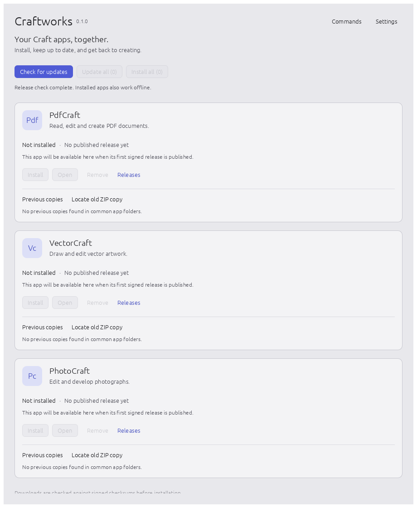

# Craftworks

One desktop app to install, update and open **PdfCraft, VectorCraft and PhotoCraft** on
Windows and Linux. It also holds the shared libraries used by the wider craft app family.

Craftworks installs apps for your user account, without administrator access: verified Windows
portable packages and Linux AppImages. Updates are checked against a signed checksum list
before any downloaded app is installed.

**Release status:** none of these three app repositories has a published release yet. The
launcher can be built and run now; app installation becomes available after maintainers publish
their first signed releases and configure the launcher's trusted public keys. See
[`docs/launcher.md`](docs/launcher.md) for setup, platform details and the release checklist.

```sh
cargo run -p craftworks
```

Downloadable Craftworks builds are produced by
[`launcher-release.yml`](.github/workflows/launcher-release.yml): a Windows installer and
portable zip, and a bundled Linux setup script or tarball with a user installer. Update the launcher itself by running
the newer installer; this first version centralizes updates for the three apps.

The shared pieces:

- [`DESIGN.md`](DESIGN.md): the design direction every craft app follows. One design of our own,
  consistent across apps; feature parity with the professional apps they target, without copying
  their look.
- [`crates/craft-ui`](crates/craft-ui): that design as code, for egui: tokens, themes and the
  shared components (command palette, Undo toasts, inspector sections, empty states, buttons).
- [`crates/craft-update`](crates/craft-update): in-app updates (check, download, verify a signed
  checksum list, install on quit). [`docs/updates.md`](docs/updates.md) covers installers and
  the signing keys.
- [`crates/craft-manager`](crates/craft-manager): the desktop launcher's app catalogue,
  verified downloads and managed installations.
- [`apps/craftworks`](apps/craftworks): the native Windows and Linux launcher.



[Dark appearance](docs/images/launcher-dark.png) · [The shared editing shell](docs/images/shell-light.png)

MIT or Apache-2.0, at your option.

Linux packages include the Wayland frame and fallback-font notices in
`THIRD-PARTY-NOTICES.txt`.
