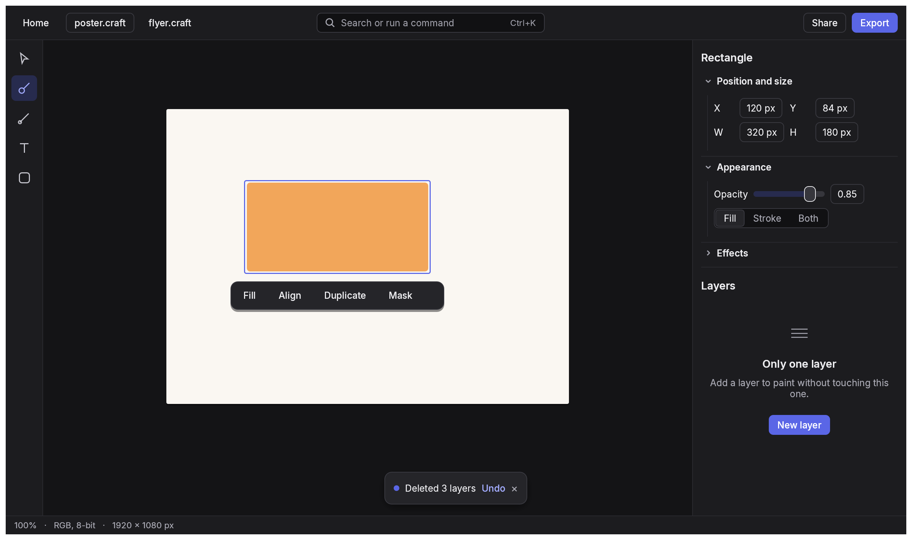

# craft-ui

The shared design system of the craft apps: one set of design tokens (colour, type, spacing,
radius, motion), the egui style built from them, and the components every app uses (command
palette, toasts with Undo, inspector sections, empty states, buttons, tooltips, Settings ›
Appearance). The direction and the rules are in [`DESIGN.md`](../../DESIGN.md).



## Use

```toml
craft-ui = { git = "https://github.com/treeforjs/craftworks", tag = "craft-ui-v0.1.0" }
```

```rust
// Startup: fonts (the app embeds its own faces) and the icon painter.
craft_ui::fonts::install(ctx, my_font_definitions());
craft_ui::icons::set_painter(ctx, my_lucide_painter);

// Every frame.
let t = craft_ui::apply(ctx, &settings.theme);
palette.handle_shortcut(ctx);
if let Some(id) = palette.show(ctx, &palette_items) { app.run(&id); }
if let Some(id) = toasts.show(ctx, status_bar_height) { app.run(&id); }
```

egui 0.36, pure Rust, no `unsafe`, no panics in library code, builds for wasm32.

## Develop

```sh
cargo fmt --check && cargo clippy --all-targets -- -D warnings && cargo test
cargo check --target wasm32-unknown-unknown
CRAFT_UI_FONTS=../pdfcraft/assets/fonts cargo run -p craft-ui --example gallery -- target/gallery  # screenshots
```

The gallery renders headlessly with wgpu; on Linux without a GPU install Mesa's software Vulkan
driver (`mesa-vulkan-drivers`).

## Licence

MIT or Apache-2.0, at your option.
